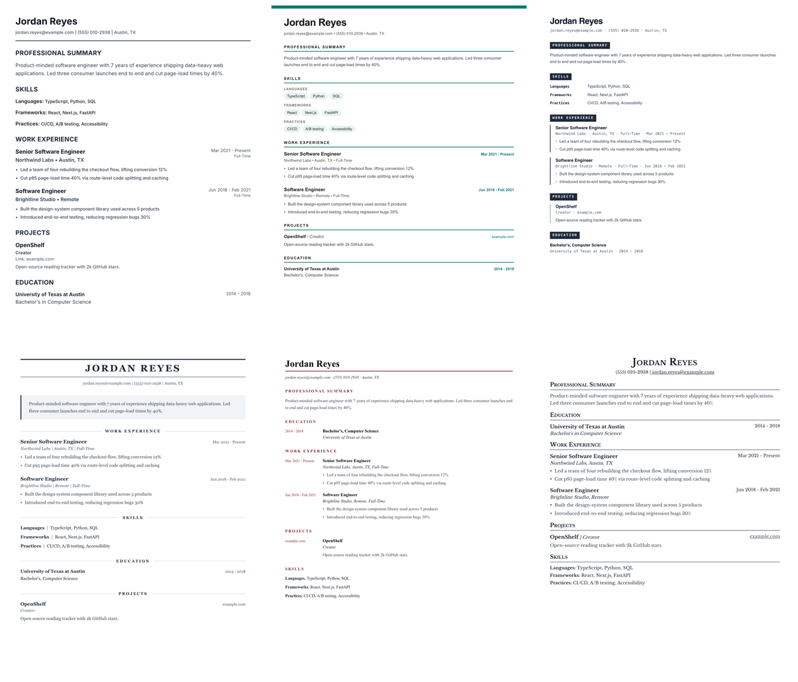

<div align="center">

# Resume Builder

**Paste a job posting. Watch an ATS-friendly resume write itself against it, live.**

[](LICENSE)
[](https://nextjs.org)
[](https://react.dev)
[](https://www.typescriptlang.org)
[](https://supabase.com)
[](#testing)

[Quick start](#quick-start) · [How it works](#how-it-works) · [Templates](#templates) · [Testing](#testing) · [Contributing](CONTRIBUTING.md)


</div>

---

## What this is

Most resume tools give you a pretty document that an applicant tracking system
cannot read. This one starts from the opposite constraint: **every template is
single column, standard headings, real selectable text, no tables or images**,
so a parser sees what a human sees.

You keep one profile. For each application you paste the posting, pick a
template, and the AI rewrites your material against that specific job while you
watch it appear.

## Features

| | |
|---|---|
| **Live streaming generation** | The resume renders section by section as the model writes it, in the template you picked. No spinner, no guessing. |
| **Strict and free modes** | Strict rewrites only what is in your profile. Free lets the model lean toward the posting. Your companies, dates and titles never change in either. |
| **Six ATS-safe templates** | Distinct designs, one shared rule set. Switch at any time, including after generating. |
| **Text-based PDF export** | Exports through the browser print pipeline, so the PDF holds selectable text a parser can read, not a screenshot. |
| **Resume import** | Upload an existing resume and it is parsed into your profile to start from. |
| **AI text enhancement** | Rewrite a single work experience or project description without regenerating everything. |
| **Highlighting** | Optionally mark the phrases that best match the posting, so a skim lands on the right lines. |
| **Accessible by default** | Keyboard paths, focus management, live regions and contrast are covered by their own test suite. |

## Quick start

**Prerequisites:** Node.js 24+ (`nvm use` reads `.nvmrc`), plus a
[Supabase](https://supabase.com) project and an
[OpenRouter](https://openrouter.ai) API key.

```bash
git clone https://github.com/ashishtz/AI-resume-builder.git
cd AI-resume-builder
npm install
cp .env.example .env.local   # then fill in the values below
```

```bash
# .env.local
NEXT_PUBLIC_SUPABASE_URL=https://your-project.supabase.co
NEXT_PUBLIC_SUPABASE_ANON_KEY=your-anon-key
OPENROUTER_API_KEY=sk-or-v1-your-key
# optional, defaults to anthropic/claude-sonnet-4
# OPENROUTER_MODEL=anthropic/claude-sonnet-4
```

Apply the database schema, then start the app:

```bash
supabase db push     # or run supabase/migrations/*.sql against your project
npm run dev
```

Open <http://localhost:3000>.

<details>
<summary><b>Running everything locally, including the database</b></summary>

The [Supabase CLI](https://supabase.com/docs/guides/cli) runs the whole stack in
Docker, which is what the end-to-end suite expects:

```bash
supabase start          # prints your local URL and keys
supabase status         # copy the API URL, publishable key and secret key
```

Point `.env.local` at the local stack and add the service-role key, which the
E2E seed uses to create its demo account:

```bash
NEXT_PUBLIC_SUPABASE_URL=http://127.0.0.1:54321
NEXT_PUBLIC_SUPABASE_ANON_KEY=<publishable key from supabase status>
SUPABASE_SERVICE_ROLE_KEY=<secret key from supabase status>
```

</details>

## How it works

```
Profile data ──┐
               ├──► prompt (lib/prompts) ──► OpenRouter ──► NDJSON stream ──► live preview
Job posting ───┘                                                │
                                                                └──► normalize ──► Postgres (RLS)
```

- **Prompts live in `lib/prompts/`**, one `ChatPromptTemplate` per feature. The
  system message carries every instruction; the user message carries only data.
  A contract test formats the real template with the real variable builder, so
  a renamed variable breaks CI rather than production.
- **The model streams**, and each chunk is parsed with `parsePartialJson` and
  normalized, so a half-finished object is still renderable. That is what makes
  the live preview possible.
- **`normalizeResumeData` is the trust boundary.** Model output is coerced into
  the exact shape templates render before it is stored or displayed. Nothing
  downstream defends against a missing key.
- **Postgres row-level security** scopes every table to its owner. The browser
  only ever holds a publishable key.

## Templates



| Template | Best for |
|---|---|
| **Classic** | The safe default. Reverse-chronological, nothing decorative. |
| **Modern** | Accent bar, tinted skill chips, skills placed above experience. |
| **Technical** | Monospaced metadata and ruled entries, built for engineers. |
| **Executive** | Formal masthead and roomy leading for senior roles. |
| **Academic** | Education first, years in a left gutter, scholarly setting. |
| **Compact** | Dense LaTeX-inspired sheet that fits a lot on one page. |

Every one of them obeys the same rules, which are the reason they parse:

- one column, so reading order cannot scramble
- standard headings only (`Professional Summary`, `Skills`, `Work Experience`, `Education`, `Projects`)
- real text everywhere, never an image, table, text box or icon carrying meaning
- system font stacks and plain bullets

## Testing

```bash
npm run typecheck   # tsc, no emit
npm run lint        # eslint
npm test            # jest unit tests
npm run e2e         # playwright, needs a running Supabase + npm run build
```

The end-to-end suite covers every page and flow, and seeds its own demo account
so it does not depend on hand-made data. Generation is intercepted at the
network layer, so the suite never spends OpenRouter credits. See
[`e2e/README.md`](e2e/README.md) for the first-run setup.

Three of those suites exist to stop specific regressions: `a11y.spec.ts`
(structural accessibility invariants), `copy.spec.ts` (house copy rules) and
`session-expiry.spec.ts` (auth recovery).

## Project structure

```
app/                    Routes, layouts and API handlers
  api/                  parse-resume · enhance-text · resumes/generate
  dashboard/            documents (list, new, view, edit) · profile
  onboarding/           five-step first-run flow
components/
  resume-templates/     The six templates plus their shared pieces
  forms/                Field groups shared by profile and onboarding
  ui/                   Buttons, fields, modal, toast, table primitives
lib/
  prompts/              One ChatPromptTemplate per feature
  services/             AI client and resume generate/parse/enhance
  repositories/         All database access
  utils/                normalize-resume is the model-output trust boundary
e2e/                    Playwright suite and its seeded demo account
supabase/migrations/    Schema, RLS policies and data migrations
```

## Contributing

Issues and pull requests are welcome, especially new templates. Read
[CONTRIBUTING.md](CONTRIBUTING.md) first. The short version: describe what
changed and why, include before and after screenshots for anything visual, and
make sure `npm run lint && npm run typecheck && npm test` passes.

## Security

Never commit `.env.local` or any real key. If you find a vulnerability, please
report it privately rather than opening a public issue. See
[SECURITY.md](SECURITY.md).

## License

[Apache License 2.0](LICENSE). You may use, modify and distribute this,
including commercially, provided you keep the license and attribution notices.
